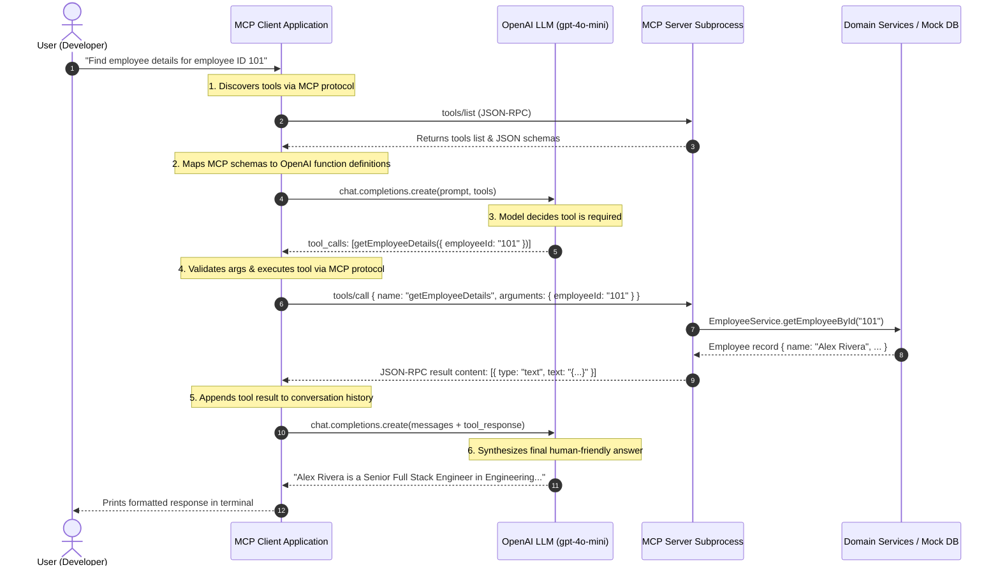

# Model Context Protocol (MCP) Server & Client Demo

An enterprise-grade Proof of Concept (POC) demonstrating the **Model Context Protocol (MCP)**, AI tool integration, and the architectural distinction between a Large Language Model (LLM) and an AI Agent. Built with **Node.js**, **TypeScript**, the official **`@modelcontextprotocol/sdk`**, and the **OpenAI API**.

---

## 📑 Table of Contents

- [Architectural Overview](#-architectural-overview)
- [Conceptual Deep Dive: LLM vs. AI Agent vs. MCP](#-conceptual-deep-dive-llm-vs-ai-agent-vs-mcp)
- [Project Structure](#-project-structure)
- [Prerequisites & Technology Stack](#-prerequisites--technology-stack)
- [Quick Start Guide](#-quick-start-guide)
- [Available MCP Tools](#-available-mcp-tools)
- [MCP Inspector Testing](#-mcp-inspector-testing)
- [One-Hour Knowledge-Sharing Session Kit](#-one-hour-knowledge-sharing-session-kit)
- [Five Practical Q&A for Team Discussions](#-five-practical-qa-for-team-discussions)
- [Three Real-World Enterprise Use Cases](#-three-real-world-enterprise-use-cases)
- [Security, Reliability & Best Practices](#-security-reliability--best-practices)

---

## 🏛 Architectural Overview



---

## 🧠 Conceptual Deep Dive: LLM vs. AI Agent vs. MCP

### 1. What is an LLM?
A **Large Language Model (LLM)** is a statistical pattern-prediction engine trained on large corpora of text. By default:
- It is **stateless** and **passive** (it only outputs text when prompted).
- It possesses **no direct access** to live databases, internal APIs, or external environments.
- Its knowledge is frozen at its training cutoff.

### 2. What is an AI Agent?
An **AI Agent** is an autonomous system that uses an LLM as its reasoning engine ("brain") surrounded by a **control loop**, **memory**, and **tools**:
$$\text{AI Agent} = \text{LLM (Reasoning)} + \text{Tools (Action)} + \text{Environment (Perception)} + \text{Control Loop (Planning)}$$
Not every LLM application is an agent:
- A chatbot summarizing text pasted by a user is **not** an agent.
- A system that receives a high-level goal, inspects its available tools, plans intermediate steps, executes tools to fetch data, observes errors, self-corrects, and iterates to a conclusion **is an AI agent**.

### 3. What is an MCP Server?
An **MCP Server** is an application that exposes data, prompts, or executable tools to AI clients via the standardized Model Context Protocol. It acts as an adapter layer over proprietary databases, APIs, or filesystems.

### 4. What is an MCP Client?
An **MCP Client** is the orchestrator that maintains sessions with one or more MCP servers. It dynamically queries server capabilities, passes tool schemas to the LLM, securely routes tool execution requests from the LLM to the appropriate server, and returns the results.

### 5. What is a Tool Call?
A **tool call** (or function call) occurs when an LLM determines that answering a user prompt requires external data or action. Instead of generating conversational text, the model emits a structured JSON payload specifying:
- The **name** of the tool to invoke.
- The **arguments** adhering to that tool's schema.
*The LLM itself never executes the code.* The host client executes the tool and passes the output back to the model.

### 6. How does MCP differ from a normal REST API?

| Feature | Standard REST API | Model Context Protocol (MCP) |
| :--- | :--- | :--- |
| **Primary Consumer** | Software developers writing code | AI Models & LLM Agents |
| **Contract Discovery** | Manual (OpenAPI/Swagger docs read by devs) | Autonomous runtime discovery via `tools/list` |
| **Transport** | Strictly HTTP/HTTPS | Standard I/O (`stdio`), HTTP with SSE, WebSockets |
| **State & Lifecycle** | Typically stateless request/response | Stateful bi-directional session with capabilities negotiation |
| **Ecosystem Interoperability** | Every company invents bespoke endpoints | Universal standard; one server connects to Claude, Antigravity, Custom Agents |

### 7. Does MCP itself provide intelligence or make an application an agent?
**No.** MCP is strictly a **communication protocol** (like HTTP or JSON-RPC). It provides zero intelligence on its own. Intelligence arises from the LLM reasoning over the tools and the control loop that orchestrates them.

---

## 📂 Project Structure

```
d:/DemoMCP/
├── src/
│   ├── shared/
│   │   └── schemas.ts              # Zod domain entities & tool input schemas
│   ├── server/
│   │   ├── index.ts                # MCP Server entrypoint (Stdio transport)
│   │   ├── data/
│   │   │   └── mockData.ts         # In-memory employee & project datasets
│   │   ├── services/
│   │   │   ├── employeeService.ts  # Employee domain business logic
│   │   │   ├── projectService.ts   # Project domain business logic
│   │   │   └── salaryService.ts    # Salary breakdown computation
│   │   └── tools/
│   │       ├── employeeTools.ts    # getEmployeeDetails, listEmployees
│   │       ├── projectTools.ts     # getProjectDetails
│   │       └── salaryTools.ts      # calculateSalaryBreakdown
│   └── client/
│       ├── index.ts                # Client entrypoint & CLI demo runner
│       ├── mcpClient.ts            # MCP Client lifecycle & stdio transport
│       ├── llmService.ts           # OpenAI agent loop & offline simulation
│       └── toolMapper.ts           # MCP Schema <-> OpenAI Tool Schema translator
├── scripts/
│   ├── verify-services.ts          # Unit verification for domain logic
│   ├── verify-server.ts            # Integration verification for MCP server
│   └── verify-client.ts            # Subprocess verification for MCP client
├── .env.example                    # Template for environment variables
├── .env                            # Local configuration (API keys)
├── .gitignore                      # Secrets & build artifact protection
├── package.json                    # Scripts and dependency specifications
├── tsconfig.json                   # TypeScript NodeNext ESM configuration
└── README.md                       # Comprehensive guide & presentation kit
```

---

## 🛠 Prerequisites & Technology Stack

- **Node.js**: v20+ or v22 LTS (Active LTS recommended)
- **TypeScript**: v5.7+
- **MCP SDK**: `@modelcontextprotocol/sdk` (v1.6+)
- **OpenAI Node SDK**: `openai` (v4.86+)
- **Validation**: `zod` (v3.24+)
- **Runtime Executor**: `tsx` (TypeScript Execute without manual transpile step)

---

## 🚀 Quick Start Guide

### 1. Install Dependencies
```bash
npm install
```

### 2. Configure Environment (Optional for Live GPT)
Copy `.env.example` to `.env`:
```bash
# Set your OpenAI API key for live GPT-4o-mini reasoning:
OPENAI_API_KEY=sk-...
```
> **Note**: If `OPENAI_API_KEY` is not provided, the application runs in **Simulated Agent Mode**, demonstrating the identical tool-calling and response synthesis flow offline!

### 3. Run Automated Tests
```bash
# Verify domain business logic
npm run test:services

# Verify MCP Server tool registration & JSON-RPC responses
npm run test:server

# Verify MCP Client connection over stdio subprocess
npm run test:client
```

### 4. Run the AI Agent Demo
```bash
# Runs the full AI Agent loop across 5 canonical scenarios
npm run client

# Run a custom natural-language question
npm run client "Calculate the total salary for basic 70000 and allowances 15000"

# Run in direct protocol mode (invokes MCP server without LLM)
npm run client:direct
```

---

## 🧰 Available MCP Tools

| Tool Name | Parameters | Description |
| :--- | :--- | :--- |
| `getEmployeeDetails` | `{ employeeId: string }` | Returns name, designation, department, and corporate email. Returns graceful not-found message if ID does not exist. |
| `listEmployees` | `{}` | Returns all active employees in the organization. |
| `calculateSalaryBreakdown` | `{ basicSalary: number, allowances?: number }` | Computes gross salary total with currency formatting. |
| `getProjectDetails` | `{ projectId: string }` | Returns project status, tech stack, and tech lead ID. |

---

## 🔍 MCP Inspector Testing

The official **MCP Inspector** provides an interactive web UI to explore tools, trigger requests, and inspect raw JSON-RPC messages.

Run the inspector with:
```bash
npm run inspector
```
1. Open the URL displayed in the terminal (typically `http://localhost:5173` or `http://localhost:6274`).
2. Verify that `getEmployeeDetails`, `listEmployees`, `calculateSalaryBreakdown`, and `getProjectDetails` appear in the **Tools** tab.
3. Test tool inputs directly in the browser and inspect the structured output.

---

## 🤖 Claude Desktop Integration

To connect this server directly to **Claude Desktop** (similar to `uv run fastmcp install claude-desktop` in Python):

```bash
# Automated 1-command installer
npm run install:claude       # macOS/Linux
npm.cmd run install:claude   # Windows
```
See [CLAUDE_README.md](file:///d:/DemoMCP/CLAUDE_README.md) for full configuration details.

---

## 🎤 One-Hour Knowledge-Sharing Session Kit

Use this structured agenda for your team presentation:

| Time | Segment | Focus Area |
| :--- | :--- | :--- |
| **00:00 - 00:10** | Concepts & Motivation | • Limitations of static LLMs<br>• What is MCP and why it is the "USB-C of AI"<br>• LLM vs. AI Agent |
| **00:10 - 00:20** | Architecture Walkthrough | • Client-Server topology<br>• Stdio transport vs. SSE/HTTP<br>• Separation of business services and MCP tools |
| **00:20 - 00:40** | Live Demonstration | • Run `npm run client:direct` (show raw MCP JSON-RPC)<br>• Run `npm run client` (show AI Agent reasoning + tool dispatch)<br>• Launch `npm run inspector` (show interactive UI debugging) |
| **00:40 - 00:50** | Real-World Use Cases | • Enterprise internal tools<br>• Database/CRM assistants<br>• CI/CD and DevOps agents |
| **00:50 - 01:00** | Q&A & Team Discussion | • Addressing security, guardrails, and implementation next steps |

---

## ❓ Five Practical Q&A for Team Discussions

#### Q1: Why use stdio transport instead of HTTP for local tools?
**Answer**: `stdio` (Standard Input / Standard Output) requires no open network ports, requires no local TLS certificates, avoids port collision issues, and inherits OS process permissions. When an AI client (like Claude Desktop or our MCP client) terminates, the server process closes automatically. HTTP/SSE is preferred when the MCP server is hosted on a remote server or shared across multiple machines.

#### Q2: How does the LLM know which tool to choose?
**Answer**: During initialization, the MCP Client discovers all tools and translates their Zod/JSON schemas into OpenAI's function definitions. The LLM reads the tool `name` and `description` along with the parameter types. Based on semantic similarity between the user prompt and the descriptions, the model decides if and which tool to invoke.

#### Q3: What prevents the AI Agent from looping indefinitely?
**Answer**: In `llmService.ts`, we implement a bounded loop with `MAX_ITERATIONS = 5`. If a model repeatedly makes redundant tool calls or fails to reach a conclusion, the loop forcibly terminates, preventing runaway API costs and infinite loops.

#### Q4: Why shouldn't we call internal databases directly inside the client?
**Answer**: Decoupling the MCP server from the client allows the server to be a reusable, single source of truth. The exact same MCP server built here can be plugged into Claude Desktop, Antigravity, Cursor, or Slack bots without changing a single line of backend logic.

#### Q5: Can the LLM modify database records without user approval?
**Answer**: In production systems, read-only tools (like `getEmployeeDetails`) can execute autonomously. For mutating actions (e.g. `deleteEmployee` or `transferFunds`), MCP clients should implement **Human-in-the-Loop (HITL)** confirmation, where the client prompts the human operator before sending the execution command over MCP.

---

## 🌐 Three Real-World Enterprise Use Cases

1. **Enterprise DevOps & Incident Response Agent**
   - *Problem*: On-call engineers spend 15+ minutes gathering logs, checking pod health, and querying deployment status during an outage.
   - *MCP Solution*: An MCP server exposing tools `getPodLogs`, `restartDeployment`, and `queryDatadogAlerts`. An agent assesses the incident, collects telemetry, summarizes the root cause, and asks the engineer for approval before executing a rollback.

2. **Customer Support CRM Copilot**
   - *Problem*: Support agents switch between Zendesk, Salesforce, Stripe, and internal admin panels to resolve a single customer ticket.
   - *MCP Solution*: Unified MCP servers wrapping Salesforce (`getCustomerHistory`), Stripe (`getInvoiceStatus`), and internal logistics (`getTrackingDetails`). The LLM answers agent questions instantly with authoritative, live customer data.

3. **Secure Developer Database Assistant**
   - *Problem*: Developers write repetitive read-only SQL queries or wait for DBA approvals for data investigations.
   - *MCP Solution*: An MCP server exposing parameterized query tools with strict SQL sanitization and row-level security. The model helps explore database relationships without raw database connection credentials ever touching client machines.

---

## 🔒 Security, Reliability & Best Practices

- **Zero API Key Leakage**: API keys are isolated in `.env` and excluded via `.gitignore`.
- **Untrusted Arguments**: Tool arguments from LLMs are treated as untrusted user input and strictly validated via Zod schemas.
- **Stdio Framing Protection**: `console.log` is prohibited on the server; all logging uses `console.error` to prevent stream corruption of JSON-RPC on `stdout`.
- **Bounded Tool Calling**: Agent execution loops are capped to prevent infinite recursion.
- **Graceful Error Handling**: Non-existent entities return descriptive status messages rather than crashing the protocol connection.
# MCP-Demo
